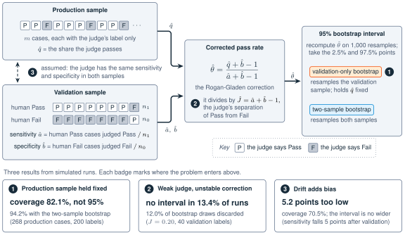
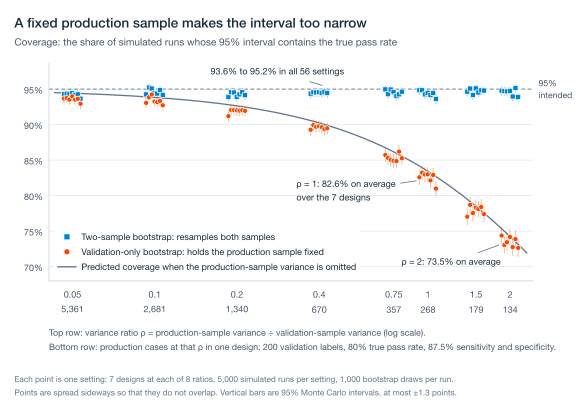
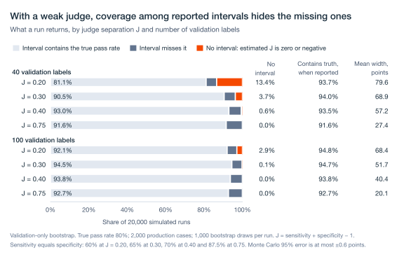
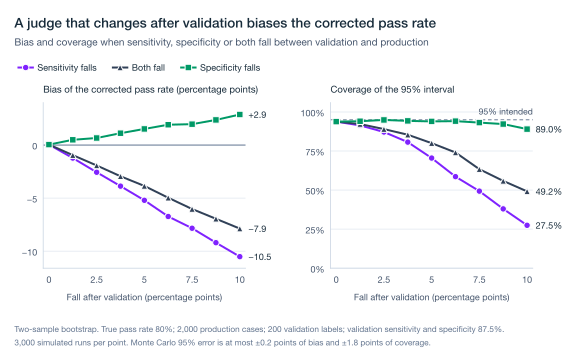

# When can you trust a bootstrap interval from an automated judge?

**Status: work in progress.** Three simulation studies are complete. The
results are not yet tested on real data.

**What we did.** We tested the 95% interval that teams put around a pass rate
when an automated judge scores the cases. The judge is often a large language
model (LLM). We ran three simulation studies with 145 settings. Each setting
repeats a simulated evaluation thousands of times, and one repetition is a
**run**. The total is 683,000 runs. Each study breaks one assumption of the
method and measures the effect.

**The method.** A team wants the **true pass rate**: the share of production
cases that a human reviewer would pass. A judge labels a **production sample**
of cases. A smaller **validation sample** also has human labels, so it shows
how often the judge is wrong. The team uses those error rates to correct the
judge's pass rate. A **bootstrap** then recomputes the corrected pass rate on
many resamples: new samples drawn with replacement from the data. The middle
95% of the results is the interval.



*Figure 1. Two samples feed one corrected pass rate, and a bootstrap gives its
95% interval. Each badge marks where one study's problem enters. Coverage is
the share of simulated runs whose interval contains the true pass rate.*

**What we found.** A bootstrap interval includes only the variance of the
samples it resamples. **Coverage** is the share of runs whose 95% interval
contains the true pass rate, and it should be 95%.

1. **Study 1: a bootstrap that holds the production sample fixed gives an
   interval that is too narrow.** With 268 production cases and 200 validation
   labels, coverage was 82.1%. With a bootstrap that resamples both samples,
   coverage was 94.2%.
2. **Study 2: a weak judge makes the correction unstable.** With 40 validation
   labels and a judge that is right 60% of the time, 13.4% of runs returned no
   interval. The returned intervals averaged 80 percentage points wide.
3. **Study 3: a change in the judge after validation biases the corrected pass
   rate.** When the judge passed 5 fewer of every 100 cases that a human would
   pass, the corrected pass rate was 5.2 percentage points too low. Coverage
   fell to 70.5%, and the interval was no wider.

**Why it matters to a national statistical office (NSO).** An NSO reports how
uncertain each estimate is, and NSOs now use machine-learning models in that
work ([UNECE, 2026](https://unece.org/sites/default/files/2026-06/Uncertainty%20Quantification%20in%20ML-Enhanced%20Statistical%20Inference.pdf)).
When an NSO uses an LLM, for example for automated coding, it needs to measure
how often the LLM is right. Human review is the costly part of that
measurement. An automated judge can do most of the checks, with a small
human-labelled sample to correct it. That is the setup tested here. The
studies show when the stated uncertainty of such a quality measure is valid,
and when it is too small.

**Value so far.** Early results are promising. In all 56 settings of Study 1,
two intervals kept coverage between 93.6% and 96.4%: the two-sample bootstrap
and a closed-form interval. One number, the variance ratio ρ, shows when the
simpler interval is safe. The studies also measure two limits that the tested
intervals do not remove: a weak judge and a judge that changed. All results
come from simulations with Pass and Fail labels.

## Contents

1. [The setup](#1-the-setup)
2. [Study 1: a fixed production sample makes the interval too narrow](#2-study-1-a-fixed-production-sample-makes-the-interval-too-narrow)
3. [Study 2: a weak judge makes the correction unstable](#3-study-2-a-weak-judge-makes-the-correction-unstable)
4. [Study 3: a change in the judge biases the corrected pass rate](#4-study-3-a-change-in-the-judge-biases-the-corrected-pass-rate)
5. [What this means for a national statistical office](#5-what-this-means-for-a-national-statistical-office)
6. [Status, limits and next step](#6-status-limits-and-next-step)
7. [Related work](#7-related-work)
8. [Reproduce the results](#8-reproduce-the-results)

## 1. The setup

A **human-Pass** case is a case that the human reviewer passes. A
**human-Fail** case is one that the reviewer fails. Differences are in
percentage points, written as points below.

| Sample | Labels | What it gives |
|---|---|---|
| **Production sample** | Judge only | The **judge pass rate**: the share of cases the judge passes |
| **Validation sample** | Human and judge | **Sensitivity**: the share of human-Pass cases the judge passes. **Specificity**: the share of human-Fail cases the judge fails |

The [Rogan-Gladen correction](https://pubmed.ncbi.nlm.nih.gov/623091/)
combines the three numbers:

$$
\text{corrected pass rate} =
\frac{\text{judge pass rate} + \text{specificity} - 1}
{\text{sensitivity} + \text{specificity} - 1}
$$

Example: the judge passes 72.5% of production cases, and its sensitivity and
specificity are both 87.5%. The corrected pass rate is
(0.725 + 0.875 − 1) / (0.875 + 0.875 − 1) = 0.600 / 0.750 = 80%.

The denominator is the judge's **separation**, J = sensitivity + specificity −
1. J is 1 for a perfect judge and 0 for a judge that guesses.

The studies compare two bootstraps.

| Bootstrap | What it resamples |
|---|---|
| **Validation-only bootstrap** | The validation sample. The judge pass rate stays fixed. |
| **Two-sample bootstrap** | The validation sample and the production sample |

The validation-only bootstrap is the procedure in Chapter 5 of
[*Evals for AI Engineers*](https://learning.oreilly.com/library/view/evals-for-ai/9798341660717/)
by Shankar and Husain, called the chapter below. The
[`judgy`](https://github.com/ai-evals-course/judgy) library implements the
same procedure. It answers a narrow question: how far does the corrected pass
rate move because sensitivity and specificity come from a small sample? It
omits the variance of the judge pass rate.

## 2. Study 1: a fixed production sample makes the interval too narrow

The production sample is a draw from a larger stream of cases, so the judge
pass rate changes from one sample to the next. The validation-only bootstrap
omits that variance.

**The loss of coverage follows the variance ratio ρ**: the production-sample
variance divided by the validation-sample variance. The formula uses these
symbols:

- **Judge pass rate (q)**: the share of cases the judge passes.
- **Production cases (m)**: the size of the production sample.
- **True pass rate (θ)**: the share of cases a human reviewer would pass.
- **Sensitivity (a) and specificity (b)**: the judge's two rates from
  section 1.
- **Validation cases (n₁, n₀)**: the numbers of human-Pass and human-Fail
  cases.

$$
\rho = \frac{q(1-q)/m}
{\theta^2 a(1-a)/n_1 + (1-\theta)^2 b(1-b)/n_0}
$$

The top is the variance of the judge pass rate. The bottom is the variance
that the estimates of sensitivity and specificity add. A larger production
sample gives a smaller ρ. To compute ρ for your own data, use your estimates
of θ, a and b.

Study 1 has 56 settings: 7 designs at 8 values of ρ. The designs use true pass
rates of 20%, 50% and 80%, and 200 to 800 validation labels. Every design has
J = 0.75. Each setting has 5,000 runs.



*Figure 2. Coverage of the validation-only bootstrap falls as the production
sample carries more of the variance. It stays just below the predicted curve.
Coverage of the two-sample bootstrap is 93.6% to 95.2% in all 56 settings.*

The table gives one design: an 80% true pass rate, 200 validation labels, and
a judge with 87.5% sensitivity and specificity. Only the production sample
size changes. **Mean width** is the average length of the interval.

| Production cases | ρ | Coverage, validation-only | Coverage, two-sample | Mean width, validation-only | Mean width, two-sample |
|---:|---:|---:|---:|---:|---:|
| 2,681 | 0.1 | 93.2% | 94.4% | 14.6 points | 15.2 points |
| 268 | 1 | 82.1% | 94.2% | 14.5 points | 20.3 points |
| 134 | 2 | 72.8% | 94.0% | 14.3 points | 24.3 points |

- **The loss is small when ρ is 0.1 or less.** With 2,681 production cases,
  coverage of the validation-only bootstrap was 93.2%. With 670 cases
  (ρ = 0.4), it was 89.6%.
- **A formula predicts the loss.** With the production-sample variance
  omitted, predicted coverage is 2Φ(1.96 / √(1 + ρ)) − 1. Φ is the standard
  normal distribution function. Measured coverage was 0.7 points below the
  prediction on average, and 2.4 points below at most.
- **Coverage of the two-sample bootstrap was 93.6% to 95.2% in all 56
  settings.** The average was 94.5%. Its interval is wider because it includes
  the production-sample variance.
- **A closed-form interval had 93.9% to 96.4% coverage with no resampling.**
  It adds the production-sample and validation-sample variances in one formula
  ([`METHOD.md`](METHOD.md#2-variance-of-the-corrected-pass-rate)).

**What if the production sample itself is the target?** A team may care only
about the cases already scored, not the stream they came from. Part of the
omitted variance still applies: the judge's errors on those cases. In the
design above, that part is 55% of the production-sample variance. At ρ = 1 the
formula then predicts about 88% coverage for the validation-only bootstrap. No
study here simulates this target or tests an interval for it.

## 3. Study 2: a weak judge makes the correction unstable

The correction divides by the estimated separation J, so a small J magnifies
an error in sensitivity or specificity. Take a true pass rate of 80% and a
5-point error in sensitivity. The corrected pass rate moves by about 20 points
at J = 0.20, and by about 5 points at J = 0.75.

Study 2 uses the validation-only bootstrap, a true pass rate of 80% and 2,000
production cases. It has 8 settings: 40 or 100 validation labels, and J from
0.20 to 0.75. Each setting has 20,000 runs. Two failures occur.

- **Some runs return no interval.** When the estimated J is zero or negative,
  the run reports nothing. The `judgy` library does the same: it raises an
  error. The code listing in the chapter does not include this rule.
- **The bootstrap discards some draws.** It discards each bootstrap draw whose
  J is zero or negative, as the chapter's code and `judgy` do.



*Figure 3. Coverage among reported intervals (the "Contains truth, when
reported" column) hides the runs that returned no interval (orange). The
reported intervals are wide (last column).*

**Coverage when reported** counts only the runs that returned an interval.
The last column counts all runs.

| Validation labels | J | Sensitivity and specificity | No interval | Draws discarded | Coverage when reported | Mean width | Reported and contains the truth |
|---:|---:|---:|---:|---:|---:|---:|---:|
| 40 | 0.20 | 60% | 13.4% | 12.0% | 93.7% | 79.6 points | 81.1% |
| 40 | 0.30 | 65% | 3.7% | 6.8% | 94.0% | 68.9 points | 90.5% |
| 100 | 0.20 | 60% | 2.9% | 6.3% | 94.8% | 68.4 points | 92.1% |
| 100 | 0.30 | 65% | 0.1% | 1.5% | 94.7% | 51.7 points | 94.5% |

- **Coverage when reported hides the missing intervals.** With 40 labels and
  J = 0.20 it was 93.7%, within 1.3 points of 95%. Only 81.1% of all runs
  returned an interval that contained the true pass rate.
- **The reported intervals carry little information.** With 40 labels and
  J = 0.20 they averaged 79.6 points wide, on a scale of 0 to 100. That width
  is why coverage when reported stays high.
- **A rule that keeps the discarded draws widens the interval and returns no
  missing one.** With 40 labels and J = 0.20, one such rule raised the mean
  width from 79.1 to 90.7 points. Coverage when reported rose from 93.5% to
  96.5%. The 13.4% of runs with no interval stayed.
- **A small validation sample costs coverage even with a good judge.** At
  J = 0.75, coverage was 91.6% with 40 labels and 92.7% with 100. Production
  resampling raised each by less than 1 point.

A different bootstrap rule does not fix a weak judge. More human labels and a
better judge both lowered the share of runs with no interval.

## 4. Study 3: a change in the judge biases the corrected pass rate

The correction assumes that the judge has the same sensitivity and specificity
in production as in validation. **Drift** breaks that assumption: sensitivity
or specificity changes after validation, because the judge or the cases
changed.

Study 3 uses the two-sample bootstrap, a true pass rate of 80%, 2,000
production cases and 200 validation labels. In validation the judge has 87.5%
sensitivity and specificity. In production, one or both fall by up to 10
points. Each of the 81 settings has 3,000 runs. **Bias** is the average error
of the corrected pass rate over the runs.



*Figure 4. A fall in sensitivity after validation biases the corrected pass
rate and lowers coverage, to 27.5% at a 10-point fall. The same fall in
specificity moves the corrected pass rate about one quarter as far.*

| Change after validation | Bias of the corrected pass rate | Coverage |
|---|---:|---:|
| None | 0.0 points | 93.8% |
| Sensitivity falls 5 points | −5.2 points | 70.5% |
| Specificity falls 5 points | +1.5 points | 94.0% |
| Both fall 5 points | −3.9 points | 80.0% |

- **In large samples the bias follows a rule.** Each point of lost sensitivity
  lowers the corrected pass rate by θ / J points. Each point of lost
  specificity raises it by (1 − θ) / J points. Here θ = 0.8 and J = 0.75, so
  the two rates are 1.07 and 0.27. Measured bias was within 0.3 points of the
  rule in all 81 settings.
- **The size of each effect depends on the true pass rate.** Sensitivity
  matters more here because 80% of the cases are human-Pass cases. By the
  rule, specificity matters more when the true pass rate is below 50%.
- **The interval moves but does not widen.** Its mean width stayed between
  14.6 and 15.6 points in all 81 settings. The bootstrap resamples the
  validation sample, and the validation sample does not contain the change.

These coverage values hold for these sample sizes. The fix is new human labels
from the production setting.

## 5. What this means for a national statistical office

Survey statisticians know this setup. A cheap measurement covers a large
sample, and an accurate measurement covers a small subsample. Survey sampling
calls this a two-phase design. The correction comes from epidemiology, where
it adjusts a prevalence for the errors of a screening test.

Each study answers one question that an NSO meets when an automated judge
measures the quality of a process.

| Question for the NSO | Evidence from the studies | Action |
|---|---|---|
| How do we state the uncertainty of a measured pass rate? | Study 1: coverage was 82.1%, not 95%, when the bootstrap held 268 production cases fixed | If the production sample is a draw from a larger stream, resample both samples or use the closed-form interval. Compute ρ first: at ρ = 0.4, measured coverage was 89.6% |
| Is the judge good enough to use? | Study 2: at J = 0.20 with 40 labels, 13.4% of runs returned no interval, and the returned intervals averaged 79.6 points wide | Treat a low estimated J as a judge problem. Improve the judge or collect more human labels. Report the share of discarded draws. If the estimated J is zero or negative, state that there is no interval |
| When do we validate the judge again? | Study 3: a 5-point fall in sensitivity gave a bias of −5.2 points, and the interval was no wider | If the judge or the cases change, collect new human labels. A new model version and a new survey cycle are two such changes |

## 6. Status, limits and next step

**This is work in progress.** The three studies are complete, and the scripts
reproduce every number. The work has not reached real data.

**Value so far for research and development:**

- **Two intervals held coverage near 95%.** Coverage of the two-sample
  bootstrap and the closed-form interval was 93.6% to 96.4% in the 56 settings
  of Study 1.
- **One number predicts when the simpler interval fails.** Measured coverage
  was within 2.4 points of the prediction from ρ in all 56 settings.
- **The failure cases have measured sizes.** Study 2 gives the effect of a
  weak judge, and Study 3 gives the effect of drift.
- **Every result is reproducible.** Each setting has its own seed, and the
  scripts return the same two CSV files.

**The simulations assume:**

- The human label and the judge label are both Pass or Fail, and the human
  label is the reference answer.
- The design sets the numbers of human-Pass and human-Fail validation cases in
  advance.
- The two samples are separate and independent.
- Cases are independent. They are not grouped by user, conversation or prompt
  template.
- Each case gets one judge label.
- The target is one pass rate, not a comparison between two systems.

**The settings are narrow:**

- Studies 1 and 3 use a judge with J = 0.75 and 200 or more validation labels.
- No study runs the two-sample bootstrap with a weak judge. As coded, it
  returns the whole range from 0 to 1 if any bootstrap draw has J at or below
  zero.
- Study 3 changes sensitivity and specificity by set amounts. It does not
  describe how a particular LLM judge drifts.

**Not studied:** grouped cases, repeated judge calls, disagreement between
human reviewers, judge scores on a continuous scale, and other ways to collect
the human labels.

**The next step** is a study that compares two ways to spend one budget for
human labels. The first sets the numbers of Pass and Fail labels and uses the
correction studied here. The second labels a random sample and uses PPBoot
(section 7). The measure is the interval width at 95% coverage.

## 7. Related work

- [Lee et al., ICML 2026](https://arxiv.org/abs/2511.21140) correct an LLM
  judge with the same estimator. Their confidence interval accounts for both
  samples. This repository measures what a bootstrap loses when it omits one
  sample.
- [PPBoot](https://arxiv.org/abs/2405.18379) (Zrnic, 2024) is a bootstrap for
  prediction-powered estimators, which combine a few human labels with many
  model predictions. It also resamples the labelled and the unlabelled data.
- [Stratified prediction-powered inference](https://proceedings.neurips.cc/paper_files/paper/2024/hash/c9fcd02e6445c7dfbad6986abee53d0d-Abstract-Conference.html)
  (Fisch et al., NeurIPS 2024) extends that approach to stratified samples.
- [UNECE (2026)](https://unece.org/sites/default/files/2026-06/Uncertainty%20Quantification%20in%20ML-Enhanced%20Statistical%20Inference.pdf),
  *Uncertainty Quantification in ML-Enhanced Statistical Inference: A
  Practitioner Handbook with Applications in Official Statistics*, covers
  uncertainty for machine-learning methods at NSOs.

## 8. Reproduce the results

Install NumPy and Matplotlib:

```bash
python3 -m venv .venv
source .venv/bin/activate
python3 -m pip install -r requirements.txt
```

Run Studies 1 and 3 (about 3 minutes):

```bash
python3 -c "import journal_study as js; print(js.run_final())"
```

Run Study 2 (about 30 seconds):

```bash
python3 component_ablation_study.py
```

Redraw the figures from the saved results:

```bash
python3 make_figures.py
```

The script saves each figure as SVG, PNG and PDF. The PDF files keep the text
as text. Figure 1 also needs `pdflatex` with TikZ and `pdftocairo`. Without
them, the script redraws Figures 2 to 4 and prints a warning.

Every setting has its own seed. If you run the studies again, you get the
same two CSV files.

| File | Contents |
|---|---|
| [`METHOD.md`](METHOD.md) | The model, the formulas, the study designs and the result tables |
| `judge_bootstrap_demo.py` | The data model and the intervals |
| `journal_study.py` | Study 1 (production-sample variance) and Study 3 (drift) |
| `component_ablation_study.py` | Study 2 (weak judge) |
| `make_figures.py` | Figures 1 to 4, drawn from the CSV files |
| `results/journal_final/journal_summary.csv` | One row for each setting and method in Studies 1 and 3 |
| `results/component_ablation/component_summary.csv` | One row for each setting and method in Study 2 |
